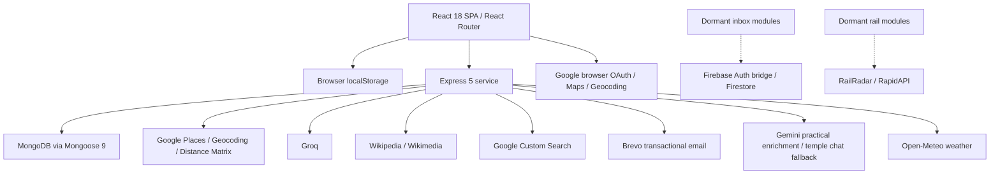

# Actual architecture and dependencies

## Runtime map

Solid arrows represent source-reachable integration paths, not successful live requests. Dormant paths are not mounted product functionality.

## Frontend

`client/src/index.js:9` mounts App in StrictMode. `client/src/App.js:20` gates routes only on token presence. App eagerly imports all eleven route components; no route lazy-loading is present. ExploreSearchProvider wraps the router and holds city selection in memory (`client/src/pages/ExploreSearchContext.jsx:8`). Each page assembles its own shell; DayPlanner/TripPlanner omit mobile sidebar controls. Global CSS from eagerly imported routes shares selectors such as `.main-content`, `.place-card`, `.hero-content`, and `.modal`, so page-specific assumptions can leak between routes.

HTTP uses a mix of fetch and axios. `client/src/config.js:1` defines an environment-dependent URL, but many active pages hardcode the Render origin. Temple pages default to localhost. There is no common unauthorized-response handling or normalized API error layer.

Persistence is split:

| Data | Actual storage | Consequence |
|---|---|---|
| JWT / displayed identity | `token`, `user` localStorage | Route access trusts presence; UI identity can differ from server identity. |
| Main planner selection | `sarathiPlan` localStorage | Global across accounts; saves places but not complete trip metadata. |
| My Trips | Mongo `Trip` | Current schema drops submitted itinerary fields. |
| Saved page | `savedTrips_<userId>` localStorage | Not synchronized with Mongo SavedTrip or temple/recommendation hearts. |
| Temple hearts | `sarathi_saved_temples` localStorage | Global browser collection of IDs only. |
| Recommendation hearts | React Set | Lost on unmount. |
| Notifications | `sarathiNotifications` localStorage | Same/cross-tab synchronization exists; account scoping does not. |
| General chat | Mongo `ChatSession`, keyed by submitted string | Caller chooses another session ID; one session per user; some structured turns are not recorded. |
| Inbox | Dormant Firestore consumer | No active Navbar integration, in-repo rules, index config, producer, or custom-token endpoint. |

## Backend and database

`server/server.js:7` loads dotenv before route imports, starts Mongo connection without awaiting it (`:28`), applies unrestricted CORS (`:32`), and mounts twelve API groups (`:35–46`). Routes/controllers/services form a conventional small monolith. Trip and Saved routes contain inline handlers while separate savedController is unused. Chat routing combines orchestration, persistence, intent dispatch, and state transitions in 660 lines; ConversationService is 1,092 lines. Preserve the monolith but give these responsibilities explicit testable boundaries.

| Model | Fields / constraints | Review implications |
|---|---|---|
| User | username, unique email, required password, timestamps | No provider subject, email-verification state, token version, account settings, or deletion lifecycle. |
| Otp | normalized email, plaintext code, purpose, passwordHash, expiry | Unique `(email,purpose)` and TTL; no failed-attempt counter or consumed reset nonce. |
| Trip | userId, name, image, date, time, budget string, note | No destination/places/travelers/date range/schedule. No declared user/time compound index. |
| SavedTrip | userId index, templateName, destination, places, date range, mixed itinerary, notes, source | Active route still writes legacy fields; schema discards them. |
| ChatSession | unique indexed string userId; trip Mixed; bounded history in service; nearby/entity fields | Request-driven identity; no retention TTL; non-atomic read/create/save and concurrent update risk. |

Mongoose schemas are not a substitute for request validation. Dates are strings or Mixed in planning data; no centralized place/trip DTO or OpenAPI/Postman contract was discovered.

## Integration ownership and configuration

| Integration | Active configuration names | Source owner / concern |
|---|---|---|
| Google Places | `GOOGLE_API_KEY`, `GOOGLE_PLACES_KEY` | Different modules require different keys; photo URLs carry backend key values to clients. |
| Geocoding/autocomplete | `GOOGLE_GEO_KEY`; hardcoded browser key | Backend reverse route exists but Dashboard/Explore bypass it. |
| Google OAuth | hardcoded browser client ID; `JWT_SECRET` for SARATHI token | Backend does not validate the provider credential. Client IDs are public identifiers, not secrets. |
| Mongo | `MONGO_URI` | Actual Atlas backup, privileges, and connection settings are not available. |
| Groq | `GROQ_API_KEY` | Central wrapper and separate food SDK client; model/output/time-budget behavior differs. |
| Gemini | `GEMINI_API_KEY` | Active templeDataService differs from dormant queued geminiService. |
| Brevo | `BREVO_API_KEY`, `SENDER_EMAIL` | Active mailer, despite nodemailer/resend dependencies. |
| Custom Search | `GOOGLE_API_KEY`, `GOOGLE_CSE_ID` | Active food images; dormant sourceCascade. |
| Firebase | `REACT_APP_FIREBASE_*`, token endpoint variable | Dormant inbox; rules not discoverable. |
| Rail | `RAILRADAR_API_KEY`, RapidAPI host/key | Dormant; do not claim live fare support. |

Only names are documented; no credential values are reproduced.

## Dead and incomplete paths

- `server/controllers/historyController.js:15` and its historyGenerator/storyShaper/wikiSectionExtractor/sourceCascade pipeline are not imported by mounted routes. The active history UI consumes `/enriched` instead.
- `server/services/transport/FareSourceService.js:13` contains non-resolving relative imports; TrainFareService imports the wrong journey-date export and uses incompatible fallback class codes. No active chat import connects this fare board.
- `server/routes/search.js` is an unmounted ES-module alternative to active CommonJS geocode routes; `server/routes/useExploreSearch.js` is empty.
- `server/services/youtubeService.js` is empty but actively destructured/called by templeController; unlike other dormant files, this breaks a mounted endpoint.
- `MapView`, `AuthLayout`, `Navbell_notifications`, InboxDropdown/useInbox/Firestore, standalone ErrorBoundary, PlacesService, curatedPlaces, and geminiService have no active application import path found. They still need safe treatment if reconnected.

## Deployment and dependency evidence

README names Vercel, Render, and Atlas. Only `client/vercel.json:1` supplies hosting configuration (SPA rewrite). No Render manifest, Dockerfile, CI workflow, backup runbook, health/readiness implementation, environment example, or committed Firestore rules was found in authored files. Dashboard URLs do not prove deployment configuration.

Lockfile version 3: 1,408 client package records and 164 server package records; root dependency maps match package.json exactly. Neither package manifest pins Node engines. Node used for checks: 22.22.2. There are 5,258 Git-tracked server vendor files despite ignore rules; ignore rules do not untrack existing files. No vulnerability status, production bundle size, throughput, or provider quota is inferred from package versions.

Scale within this architecture first: bounded request validation, per-user budgets, timeouts and concurrency caps, paginated indexed collections, atomic chat transitions, bounded caches, and readiness/telemetry. Consider service extraction only when measured bottlenecks justify it. These changes protect travelers from lost work and stalled screens; validate through the roadmap's isolated failure and persistence tests.
